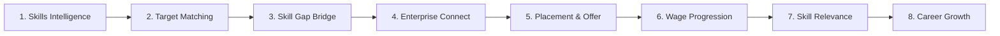
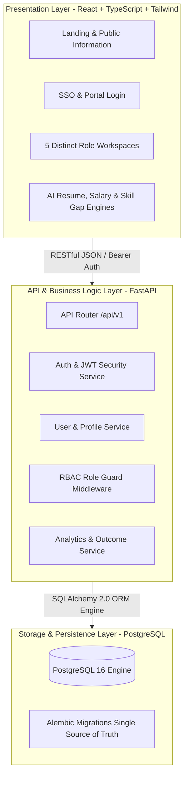
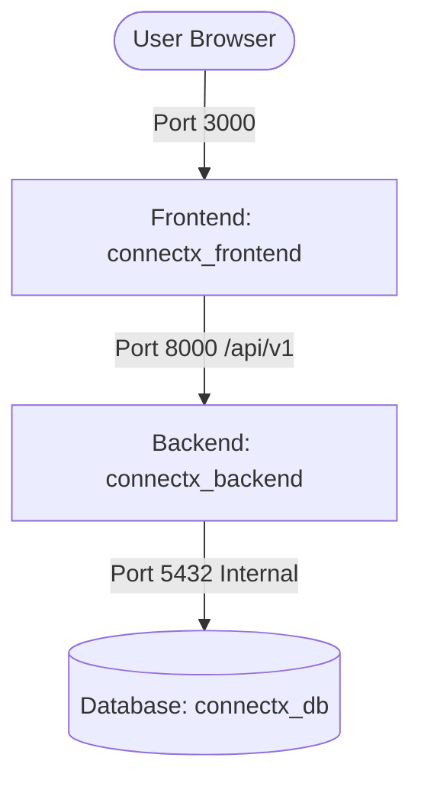

# CONNECTX - System Architecture & Technical Specification

> **Platform**: CONNECTX — Global Skill-to-Employment Intelligence Platform  
> **Tagline**: *"Your Skills. Their Opportunities. A Better Future."*  
> **Smart India Hackathon 2026** | **Problem ID: 26135**  

---

## 1. Executive Problem & Technical Mission

Current vocational skilling ecosystems suffer from a severe structural blindspot: government dashboards only measure **initial batch completion and single-point placement**. There is virtually no mechanism to track:
1. Whether placed youth remain in the job after 3, 6, and 12 months (**Retention Rate**).
2. How wages evolve over time (**Wage Velocity & 5-Year Progression**).
3. Whether skills taught match actual job requirements (**Skill Gap & Curriculum Relevance**).
4. Long-term socio-economic upward mobility (**Longitudinal Career Growth**).

**CONNECTX** provides a unified, consent-driven longitudinal architecture tracking candidates throughout their entire career lifecycle.

---

## 2. High-Level System Architecture

---

## 3. Five Distinct Role-Based Experience Architecture

CONNECTX enforces strict RBAC segregation across 5 core stakeholder perspectives:

1. **Candidate Workspace (`/candidate`)**: Career Score (86/100), 5-Year Salary Trajectory, Skill Gap Benchmark, AI Resume Intelligence, and Global Job Marketplace.
2. **Company / Employer Console (`/company`)**: Requisition Management, 5-Stage Hiring Funnel (`Apply → Screen → Interview → Offer → Hire`), AI Candidate Matching, and Talent Scarcity Telemetry.
3. **Recruiter Hub (`/recruiter`)**: Natural-Language AI Talent Search, Pre-Vetted Candidate Rankings, Shortlists, and Fast Interview Scheduling.
4. **Training Provider Console (`/provider`)**: Learner Cohorts, Outcome Metrics, and the **"What Companies Need vs What We Teach"** Curriculum Gap Matrix.
5. **Ecosystem Admin (`/admin`)**: Macro Labor Market Health, Global Skill Supply & Demand Indices, DPDP / GDPR Consent Audit Ledger, and Security Telemetry.

---

## 4. Data Privacy & Zero-Trust Consent Framework

* **Informed Consent**: Candidates explicitly grant consent for their employment verification and wage progression tracking.
* **Revocability**: Candidates can revoke tracking consent at any time via their profile portal.
* **Audit Trail**: Every consent grant or modification records an exact timestamp (`consent_date`) and policy version (`consent_version`).
* **Role Isolation**: Employers can only see candidates they have hired or shortlisted; Academies can only view enrolled learners; Admins govern aggregated macro statistics.

---

## 5. Docker Deployment Topology

The entire ecosystem runs with a single command via Docker Compose:

* **Network**: Isolated bridge network `connectx_network`.
* **Volumes**: Persistent volume `postgres_data` ensures zero data loss across container restarts.
* **Healthchecks**: Backend container waits for database `pg_isready` check before starting FastAPI server.
